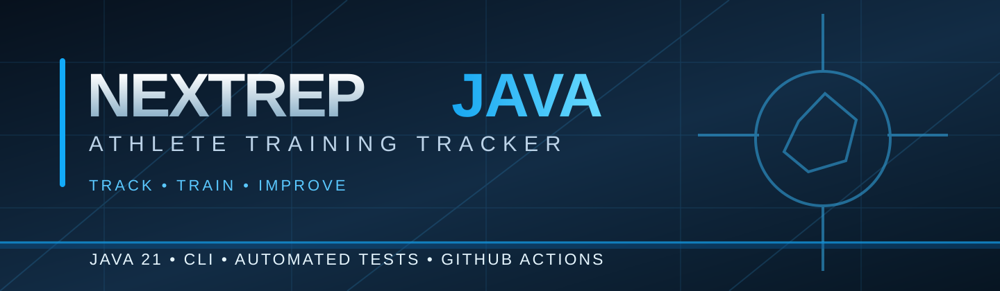
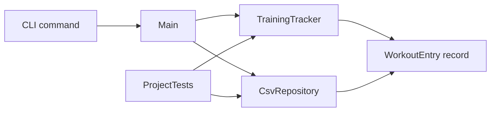

# NextRep Java — Athlete Training Tracker

   [](https://github.com/brovy23-GD/Next-Rep-Java/actions/workflows/java.yml)

**A dependency-free Java 21 command-line application that records athlete training sessions and summarizes training volume.** Built to demonstrate Java records, object-oriented programming, collections, Streams, input validation, CSV persistence, automated regression checks and CI.

By [Bobby Rovy](https://github.com/brovy23-GD) | [LinkedIn](https://www.linkedin.com/in/bobbyrovy)

## What works

- Add a training session with athlete, exercise, repetitions, duration, date and generated UUID.
- List all sessions or filter athletes case-insensitively.
- Calculate training sessions, total repetitions, minutes and exercise frequency.
- Delete sessions by UUID.
- Save and load a local UTF-8 CSV file. Free-text fields use Base64-safe encoding, **not encryption**.
- Validate missing text, invalid numbers, dates and duplicate session identifiers.
- Run a self-contained demonstration without writing to the data file.
- Execute a standalone Java test harness with **17 assertions**.

**Verification status:** Local compilation, 17 assertions and the demo were verified with OpenJDK 21. The GitHub Actions workflow is included; review the live badge and [Actions](https://github.com/brovy23-GD/Next-Rep-Java/actions) page for remote CI status.

## Technology stack

| Area | Implemented |
| --- | --- |
| Language | Java 21 |
| Model | Immutable Java `record`, `UUID`, `LocalDate` |
| Data structures | `List`, `Map`, Java Streams |
| Local persistence | Java NIO, UTF-8 CSV, atomic replacement where supported |
| Testing | Custom dependency-free test runner (17 assertions) |
| Automation | Bash script and GitHub Actions (Temurin 21) |
| Build | `javac` and `java`; no third-party dependencies |

## Architecture



Responsibilities are separated into command parsing, business logic, immutable domain records, and local file storage. Read [architecture notes](docs/architecture.md).

## Quick start

**Prerequisites:** JDK 21+ and Bash (Git Bash or WSL on Windows). From the repository root:

```bash
java -version
bash run.sh test
bash run.sh demo
```

Record and inspect practice sessions:

```bash
bash run.sh add Alex Shooting 100 45 2026-11-23
bash run.sh add Alex Defense 50 30
bash run.sh list Alex
bash run.sh summary Alex
```

Delete a specific record using its ID from `list`:

```bash
bash run.sh delete <full-session-uuid>
```

Select a different CSV file by placing `--file` first:

```bash
bash run.sh --file data/example-sessions.csv add Alex Shooting 100 45
bash run.sh --file data/example-sessions.csv summary Alex
```

**Windows PowerShell without Bash:**

```powershell
New-Item -ItemType Directory -Force build/classes | Out-Null
javac --release 21 -d build/classes src/main/java/com/rovy/nextrep/*.java
java -cp build/classes com.rovy.nextrep.Main demo
```

## Verified demonstration

```text
Alex: 3 session(s), 340 reps, 140.0 minutes
  Defense: 1 session(s)
  Shooting: 2 session(s)
```

The `demo` command uses in-memory sample entries; it does not create or modify local CSV files. Generated `data/*.csv` files are excluded by `.gitignore`.

## Tests and continuous integration

```bash
bash run.sh test
```

The custom test runner validates record fields, input validation, adding and querying entries, calculations, duplicate prevention, deletion, CSV round-trip persistence and malformed headers. **17 assertions passed in the local Java 21 environment.** This does not mean 17 JUnit tests, and no code-coverage percentage is claimed.

The [GitHub Actions workflow](.github/workflows/java.yml) compiles and runs tests and the demo on pushes and pull requests. Check its actual run before reporting a passing remote build.

## Project structure

```text
.
├── assets/nextrep-banner.svg
├── src/main/java/com/rovy/nextrep/
│   ├── Main.java
│   ├── WorkoutEntry.java
│   ├── TrainingTracker.java
│   └── CsvRepository.java
├── src/test/java/com/rovy/nextrep/ProjectTests.java
├── .github/workflows/java.yml
├── .github/pull_request_template.md
├── .github/copilot-instructions.md
├── docs/architecture.md
├── run.sh
├── CONTRIBUTING.md
├── SECURITY.md
└── README.md
```

## Limitations and roadmap

The application is currently a **single-user command-line project**, not a web dashboard, Spring Boot application, REST API or cloud service. CSV storage is local, and there is no authentication, relational database, Maven build or JUnit suite. The banner is illustration, not a UI screenshot.

Potential future upgrades include date filters, richer reporting, a standard JUnit test suite and a separate Spring Boot module when there is a clear engineering objective.

No license has been selected; do not assume permission to reuse the source as open-source licensed code.

## Portfolio context

NextRep Java intentionally highlights Java language fundamentals. My separate [Skill Builder Pro](https://github.com/brovy23-GD/Skill-Builder-Pro-) is a larger C#/.NET sports-training application with multiple clients, SQL Server and REST APIs. NextRep is **not** a duplicate full-stack implementation.

**Contact:** [LinkedIn](https://www.linkedin.com/in/bobbyrovy)
