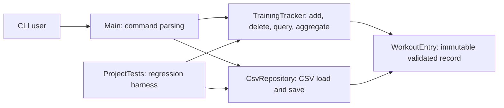

# Architecture

NextRep Java is a deliberately small, dependency-free Java 21 console application.

## Design decisions

- **Domain:** `WorkoutEntry` is a Java record containing a UUID, date, athlete, exercise, repetitions and minutes. Its compact constructor validates data.
- **Logic:** `TrainingTracker` maintains an insertion-ordered map keyed by UUID and returns sorted, filtered or aggregated views using Streams.
- **Persistence:** `CsvRepository` uses UTF-8 CSV with Base64-encoded free-text columns. It saves through a temporary file and attempts atomic replacement, falling back when unsupported.
- **Interface:** `Main` provides non-interactive commands useful for scripting and demonstration.
- **Testing:** `ProjectTests` is a standalone, dependency-free regression runner with 17 assertions. It is not JUnit, and no coverage measurement is claimed.

## Security and limits

Data is local to the file you choose; there is no authentication, cloud service, REST API or multi-user access. Base64 encoding is not encryption. Do not store sensitive personal information in this learning application.
